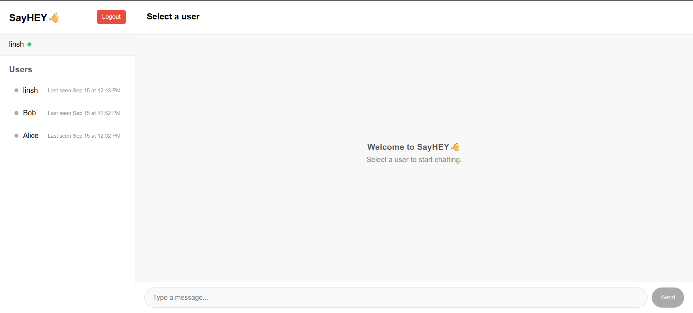

# SayHey 👋 — Real-Time Chat Application

A full-stack chat application that enables users to communicate in real time, with secure authentication and persistent message history.

## Features

- User registration and login
- JWT-based authentication
- One-to-one real-time messaging with Socket.IO
- Persistent chat history using MongoDB
- Online/offline status and last seen
- Typing indicators and message notifications
- Password hashing with bcryptjs
- Protected REST APIs

## Tech Stack

- **Frontend:** HTML, CSS, JavaScript
- **Backend:** Node.js, Express.js, TypeScript
- **Database:** MongoDB, Mongoose
- **Real-time Communication:** Socket.IO
- **Authentication:** JWT, bcryptjs

## Screenshot



## Run Locally

1. Clone the repository:

   ```bash
   git clone https://github.com/LinshaMS/Chat-Application.git
   cd Chat-Application
   ```

2. Install dependencies:

   ```bash
   npm install
   ```

3. Create a `.env` file with your MongoDB connection string and JWT secret:

   ```env
   PORT=5000
   MONGO_URI=your_mongodb_connection_string
   JWT_SECRET=your_secret_key
   ```

4. Start the application using the development script configured in `package.json`:

   ```bash
   npm run dev
   ```

5. Open `http://localhost:5000/login.html` in your browser.

## Author

**Linsha Mary** — B.Tech Computer Science and Engineering

[GitHub Repository](https://github.com/LinshaMS/Chat-Application)
